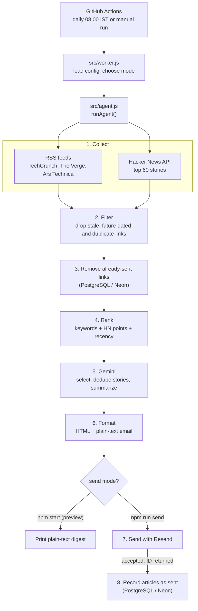

# Briefly

Briefly is a small Node.js agent that emails you a curated tech news digest every morning. It collects stories from RSS feeds and Hacker News, filters and ranks them, asks Gemini to pick the best ones and summarize them, and sends the result through Resend. It runs on a GitHub Actions schedule, so there is no server to host.

- **Automated:** runs daily at 8:00 AM IST (02:30 UTC) with GitHub Actions, or on demand.
- **No repeats:** every sent link is stored in PostgreSQL (Neon), so a story is never emailed twice.
- **Grounded summaries:** Gemini only sees titles and feed descriptions, and it can only return indices and summary text. Titles, links, sources and dates always come from the original records.
- **Safe to run:** preview mode sends nothing and records nothing, and tests need no credentials or network.

## Tech stack

| Area | Technology |
| --- | --- |
| Runtime | Node.js 24, JavaScript (ES modules), no build step |
| News sources | RSS via [`rss-parser`](https://www.npmjs.com/package/rss-parser); Hacker News public API via built-in `fetch` |
| AI | [Vercel AI SDK](https://ai-sdk.dev) (`ai`) with `@ai-sdk/google` (Gemini), structured JSON output |
| Database | PostgreSQL on [Neon](https://neon.com), accessed with [`pg`](https://www.npmjs.com/package/pg) |
| Email | [Resend](https://resend.com) |
| Scheduling / CI | GitHub Actions |
| Config | [`dotenv`](https://www.npmjs.com/package/dotenv) |
| Tests | Node's built-in test runner (`node:test`) |

## Architecture



### Pipeline in detail

1. **Collect** (`src/services/newsFetcher.js`): RSS and Hacker News are fetched in parallel. Every item is normalized to one shape: `{ title, link, description, source, publishedAt, hnScore }`.
   - RSS: three feeds, 10-second timeout, descriptions capped at 300 characters.
   - Hacker News: the first 60 top-story IDs, fetched in batches of 20 (8-second timeout for the list, 5 seconds per story). Deleted, dead and non-story items are skipped, and so are items without an external URL, such as Ask HN. When a story has no text, the description is its points and comment count.
   - Links must be valid HTTP(S). Tracking parameters (`utm_*`, `fbclid`, `gclid`, `mc_cid`, `mc_eid`) and `#fragments` are stripped (`src/utils/url.js`).
   - A failed feed or story logs a warning and the rest continue. The run only fails if every source fails.
2. **Filter** (`src/utils/articleFilter.js`): removes articles older than `MAX_ARTICLE_AGE_HOURS` or dated in the future, and removes duplicate links within the run. Undated articles are kept but get no recency bonus.
3. **Remove already-sent links** (`src/db/dbService.js`): looks up the SHA-256 hash of each link in the `articles` table and drops matches.
4. **Rank** (`src/utils/scorer.js`): scores each article (see [Ranking](#ranking)) and sorts highest first. Ties keep input order.
5. **Select and summarize** (`src/services/aiService.js`): sends at most the top 30 candidates to Gemini (see [AI step](#ai-step)).
6. **Format** (`src/services/formatter.js`): builds the subject, an HTML email and a plain-text email.
7. **Send** (`src/services/emailService.js`): only in send mode. Delivers through Resend and requires an accepted email ID.
8. **Record** (`src/db/dbService.js`): stores the selected articles, but only after Resend has accepted the email.

### Ranking

Each keyword group adds its weight once if a whole word or phrase matches the title or description.

| Keyword group | Weight |
| --- | --- |
| AI and machine learning | 10 |
| Developer tools and releases | 8 |
| Security and regulation | 7 |
| Startups and funding | 5 |
| Major tech companies | 4 |
| Cloud and infrastructure | 2 |

Hacker News points add `points / 100` (capped at 5). Recency adds up to 3 points, decreasing linearly to 0 over 12 hours. Scores are rounded to two decimals.

### AI step

- Input: up to 30 ranked candidates (`index`, title, description, source, score), plus the maximum number of stories.
- The model selects up to `TOP_ARTICLES_COUNT` stories, keeps one version of duplicate coverage, excludes opinion and promotional pieces unless clearly newsworthy, and writes 2–3 short sentences per story. It writes less when little information is available.
- Output is requested as structured JSON (`{ selected: [{ index, summary }] }`) and validated: indices must be unique integers in range, summaries must be non-empty and at most 1,200 characters, and the selection limit must hold. Any violation stops the run with an error.
- Candidate text is treated as data, never as instructions (prompt-injection guard).
- Limits: 60-second timeout, up to 2 SDK retries, 4,096 output tokens.
- The AI request is skipped when there are no candidates.

### Email

`formatEmail()` returns `{ subject, html, text }` with a dated subject and heading (`Asia/Kolkata` time zone), a story count, and numbered stories with source, summary and link. The HTML uses inline styles and a table layout for email clients. All text and link attributes are escaped, and links must be HTTP(S). An empty selection renders "No new stories today", but empty digests are never sent.

Sending has a 30-second timeout and is not retried automatically. Resend accepting an email is not the same as inbox delivery.

### Data model

One table, created automatically on startup (`CREATE TABLE IF NOT EXISTS`):

| Column | Type | Notes |
| --- | --- | --- |
| `id` | `SERIAL` | Primary key |
| `title` | `TEXT` | |
| `link` | `TEXT` | Unique, original URL (case preserved) |
| `link_hash` | `CHAR(64)` | Unique, SHA-256 of the link, used for lookups |
| `source` | `TEXT` | For example `TechCrunch` or `Hacker News` |
| `published_at` | `TIMESTAMPTZ` | Nullable |
| `sent_at` | `TIMESTAMPTZ` | Defaults to `NOW()` |
| `score` | `NUMERIC(6,2)` | Ranking score at send time |

All queries are parameterized, and inserts use `ON CONFLICT (link_hash) DO NOTHING`. The connection pool is limited to 5 connections with a 5-second connect timeout and a 10-second query timeout.

## Project structure

```
.
├── .github/workflows/daily-digest.yml   # Schedule, tests, syntax check, run agent
├── scripts/
│   ├── check.js                         # Syntax-checks every file in src/
│   └── check-db.js                      # Integration check against your real database
├── src/
│   ├── worker.js                        # Entry point: load config, pick mode, handle errors, close DB
│   ├── agent.js                         # runAgent(): the pipeline, with replaceable services for tests
│   ├── services/
│   │   ├── newsFetcher.js               # RSS + Hacker News collection and normalization
│   │   ├── aiService.js                 # Gemini selection and summaries, response validation
│   │   ├── formatter.js                 # HTML and plain-text email
│   │   └── emailService.js              # Resend delivery and settings validation
│   ├── db/dbService.js                  # Neon/PostgreSQL: schema, filterUnseen, markAsSent
│   └── utils/
│       ├── env.js                       # Environment loading and validation
│       ├── articleFilter.js             # Age filter and in-run deduplication
│       ├── scorer.js                    # Keyword, points and recency scoring
│       └── url.js                       # Link normalization
├── test/agent.test.js                   # Pipeline tests with fake services
├── .env.example
└── package.json
```

## Getting started

You need Node.js 24+, a Neon database, a Gemini API key and a Resend API key.

1. **Install**

   ```bash
   git clone https://github.com/pritamahanta/Briefly
   cd Briefly
   npm install
   cp .env.example .env
   ```

2. **Database:** create a project at [neon.com](https://neon.com) and paste its connection string into `DATABASE_URL`. Keep the `sslmode` setting from the connection string. The table is created on the first run.
3. **Gemini:** create a key in [Google AI Studio](https://aistudio.google.com/apikey) and set `AI_API_KEY`. Model access and quotas depend on your Google project.
4. **Resend:** create a key in [Resend](https://resend.com/api-keys) and set `RESEND_API_KEY`, `EMAIL_FROM` and `EMAIL_TO`. Resend's test sender (`onboarding@resend.dev`) can only send to your own Resend account email. To send to anyone else, verify a domain and use an address on it for `EMAIL_FROM`.
5. **Run**

   ```bash
   npm start       # preview: prints the digest, sends nothing, records nothing
   npm run send    # sends the digest and records its articles as sent
   ```

   `npm start` still calls Gemini when there are candidates, so it uses a little API quota.

### Configuration

Values come from the environment. Locally they are read from `.env.local` and `.env` (`.env.local` wins); variables already set in the environment win over both.

| Variable | Default | Purpose |
| --- | --- | --- |
| `DATABASE_URL` | required | PostgreSQL connection string (must be `postgres://` or `postgresql://`). |
| `AI_API_KEY` | required for AI | Gemini API key. |
| `GEMINI_MODEL` | `gemini-3.5-flash-lite` | Gemini model for selection and summaries. |
| `RESEND_API_KEY` | required to send | Resend API key. |
| `EMAIL_FROM` | required to send | One sender email address. |
| `EMAIL_TO` | required to send | One recipient email address. |
| `MAX_ARTICLE_AGE_HOURS` | `25` | Maximum article age. Positive whole number. |
| `TOP_ARTICLES_COUNT` | `8` | Maximum stories per digest. Positive whole number. |

Invalid settings stop the program with a clear error. In send mode, the email settings are validated before any news is fetched.

## Deployment (GitHub Actions)

The **Briefly** workflow (`.github/workflows/daily-digest.yml`) runs every day at 02:30 UTC (8:00 AM IST). It checks out the code, installs with `npm ci`, runs `npm test` and `npm run check`, then runs the agent with Node.js 24. Runs are serialized so two digests can never overlap, and the job times out after 10 minutes.

1. Push the repository to GitHub.
2. Open **Settings → Secrets and variables → Actions** and add these secrets: `DATABASE_URL`, `AI_API_KEY`, `RESEND_API_KEY`, `EMAIL_FROM`, `EMAIL_TO`.
3. Optionally add the variables `GEMINI_MODEL`, `MAX_ARTICLE_AGE_HOURS` and `TOP_ARTICLES_COUNT`. Without them the defaults above apply.
4. Test once from **Actions → Briefly → Run workflow**. Leave `send_email` unchecked for a preview, or tick it to send a real email and record its articles.

Scheduled runs always send. GitHub schedules can start late, only run from the default branch, and are paused on public repositories after 60 days without repository activity.

## Development and testing

```bash
npm test         # pipeline tests with fake services: no credentials, no network, no email
npm run check    # syntax-check every file in src/
npm run test:db  # checks your real database; uses its own test rows and deletes them
npm run dev      # preview mode, restarts when files change
```

`runAgent()` accepts replacement services, which is how the tests exercise the whole pipeline without external calls. They cover filtering and ranking, AI-response validation, email formatting and validation, preview isolation, empty results, missing settings, provider failures, invalid selections, link normalization, and recording only after Resend accepts the email.

`start`, `send`, `dev` and `test:db` run Node with `--network-family-autoselection-attempt-timeout=2000`, which gives each IPv4/IPv6 connection attempt 2 seconds instead of Node's short default. This avoids false timeouts on slower connections.

## Design decisions

- **Record only after acceptance.** Articles are saved as sent only after Resend returns an email ID, so a failed send never hides a story. If the email is accepted but the database write fails, the error says so and tells you to check Resend before retrying.
- **The model cannot invent links.** Gemini returns only indices and summaries, and everything else is copied from the original records.
- **Untrusted input everywhere.** Feed content is escaped in HTML, links must be HTTP(S), and prompts treat article text as data.
- **Partial failure tolerance.** One bad feed or story never stops a run. Total failure of all sources, the AI request, or the email send does.
- **No automatic email retries.** A retry after a timeout could send the same digest twice.
- **No build step.** Plain JavaScript keeps the project small. `npm run check` only verifies syntax.

## Limitations

- Duplicates are detected by URL after tracking parameters are removed. The same story at different URLs (for example, two outlets covering it) can still appear twice, although Gemini is asked to keep one version of each story.
- Summaries come from titles and feed descriptions, so they can be thin for headline-only items.
- There is one recipient and a fixed list of RSS sources, defined in `src/services/newsFetcher.js`.
